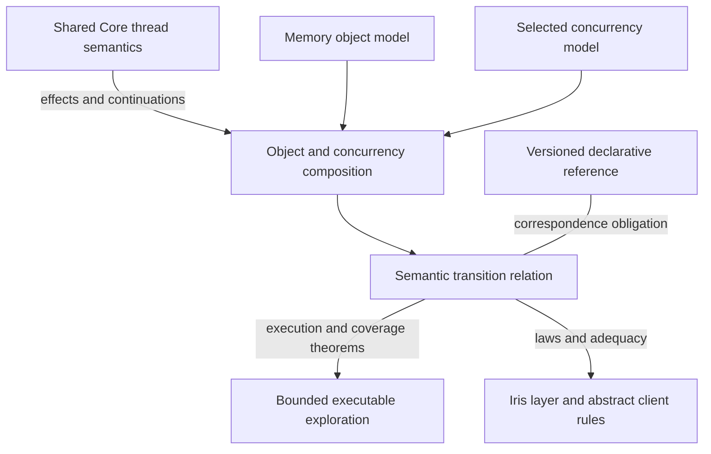

# Concurrency: repository assessment and research direction

2026-09-20, Codex. **Status: research assessment and [AGENT] recommendations,
not an implementation charter or an adoption decision.** The current user asks
for an assessment against three goals: faithfulness to ISO C, faithfulness to
upstream Cerberus, and support for reasoning, especially in `cerberus-sl`.

**Scope clarification [USER, 2026-09-20]:** this repository captures Cerberus's
operational semantics and enables reasoning in the customer. Program logic,
Iris integration, and application proofs belong in the customer. Provider
semantic definitions and laws remain in scope. The revised
[scoped proposal](2026-09-20_concurrency-scoped-proposal.md) applies that division
and distinguishes implementation coverage from theorem/test restrictions.

**Overriding constraint [USER, 2026-09-20]:** fidelity takes precedence;
Cerberus must not be restricted for reasoning reasons. A theorem can have a
limited domain without imposing that limitation on the operational semantics.
Any missing implementation coverage is a tracked port gap, not a replacement
definition of the target language.

**Revised recommendation:** pin the upstream operational account and integration
first. Evaluate SC as an initial implementation slice, with an explicit relation
to that account. Rebuild the faulty connection to Core and the memory object
model. Preserve the declarative reference and justify each claimed connection.
Do not merge the legacy executor wholesale, identify RC11 with ISO C, or promise
that selecting a future weak model preserves SC proofs automatically.

The immediate design problem is faithful memory effects and sequencing, before
the choice of weak-memory algorithm. Small SC examples are useful first
implementation/proof checkpoints, subject to the selected upstream reference;
their proof hypotheses must not become artificial runtime restrictions.
Reasoning requirements guide the presentation of those semantics; they do not
select different permitted behaviors to make a particular logic convenient.

## 1. Scope, identities, and evidence

| Item inspected | Revision / role |
|---|---|
| cerberus-lean mainline | `5407597d9eeba0259d65b728e86a860ad4614ab3` |
| Local upstream reference | `b9aeedcb4dd438763b0eef7f95ac19e93875d7de` |
| Legacy SC branch | `feature/concurrency`, `086d8762d382eff375c101f5f0c64d3ffe9bccc7` |
| Repaired legacy validation | `arc/validation-foundations-concurrency`, `86a2aea547804b78eb7f1eae633bb9c24c713b7f` |
| Current customer, read only | `/home/dev/projects/cerberus-sl`, `6dcea933dbd6452a6bdc83785af0392e00d6af3f` at inspection |
| Customer's semantics pin | `e64819de7e5169ea1ea34b284ad000a13edbcdda`, from `scripts/semantics-pin.env` |
| This assessment | Separate worktree, branch `docs/concurrency-research-20260920`, based on the mainline above |

The legacy feature has 13 commits over `31eba718e`; its repaired validation
companion adds four. Mainline has advanced 196 commits from that base. The
[September 19 pause note](2026-09-19_concurrency-pause-note.md) preserves those
branches as records and calls for selective salvage on a new branch.

This pass read source, branch history, design records, the customer's actual
language/adequacy/heap interfaces, and primary online sources. It follows
references from the standards and Cerberus developments into operational models
and Iris logics, then checks their assumptions against this codebase. This is a
targeted research survey, not an exhaustive systematic literature review.

The online [upstream commit listing](https://github.com/rems-project/cerberus/commits/master/)
served during research also ends at `b9aeedc` (August 13, 2026). That corroborates
the local reference; it is not a fresh Git fetch. Direct shell HTTPS failed DNS
resolution, while the web research tool worked. No remote refs were updated.

**Evidence distinction:** the C executions, 30/30 litmus result, and negative
instrument plants below are the retained September 19 measurements, not new
runs. This pass did not build the legacy branch, run an external model checker,
or prove a concurrency theorem. `herd7` and `cvc5` were not found on the current
shell PATH; `z3` was found. Nothing was installed. No customer file, pin, build
artifact, or branch was written. The customer already had two untracked review
files at entry; they were left alone.

## 2. What we have

| Component | Assessment and disposition |
|---|---|
| Current sequential semantics | The starting implementation and regression reference. `driver.lem:751` still has an unimplemented concurrent action path; `:1894` reports `CONCURRENCY IS BROKEN`. `CerbConcurrency.lean:23` is a `true` stub for a declarative condition. Its existence is not concurrency support. |
| Legacy executor | Useful typed selector/refusals, structured spawn/join scheduling, scalar SC examples, integer compare-exchange, and startup repairs. Salvage individually and recheck against current driver, parameters, and outcomes. |
| Legacy recording and race verdict | Replace or substantially repair. Pointer-keyed reads-from, missing memop effects, and overly strong sequencing invalidate the intended contract. |
| Axiomatic library | `frontend/concurrency/cmm_csem.lem` contains a family of reference predicates, including `SC_memory_model`, `SC_condition`, a total-order model, and an experimental footprint variant. Read the model condition, consistency predicate, and fault rules together. |
| Nienhuis operational model | `cmm_op.lem` and `Cmm_op_proofs.thy` are valuable upstream definitions and proof material. The feature's SC adapter records via `symUpdatePreEx`; it does not execute the proved commitment algorithm. |
| Cerberus-BMC | An important second upstream integration to study. Its `backend/bmc` separates Core constraints, pointer/object constraints, and concurrency constraints. It is a potential bounded comparison tool, not the proposed Lean proof kernel. |
| Validation | Keep the 30-test corpus, Python reference, recovered upstream expectations, and repaired status/observation handling. Their agreement is useful evidence, with distinct independence limits. |
| Existing design notes | The September 19 assessment/pause supersede the old landing charter. Retain its two-layer proof idea; replace its false agreement statement and overly broad model-switch promise. |

The [earlier assessment](2026-09-19_concurrency-design-assessment.md), with
[reproduction evidence](2026-09-19_concurrency-design-assessment-evidence/README.md),
established these decisive cases on both engines:

- Reading a character byte from an initialized `int`, or writing a byte and
  reading the `int`, succeeds sequentially but fails the SC reads-from check.
- A byte-versus-word conflicting access can escape the SC race detector.
- A single-thread `memcpy` followed by a load fails under SC.
- The legacy litmus helpers can accept valid-looking output from a process
  that exited unsuccessfully; the companion branch repairs this class of error.
- The proposed abstract theorem omits necessary sequencing/value hypotheses.

The current source inspection agrees with those diagnoses. In particular,
the feature's `model_check_expr` accepts all `Ememop` expressions, and its
`perform_memop_request2` has no concurrency model parameter. No new C-level
counterexample is claimed here.

### Three distinctions the redesign must preserve

**An SC predicate is not the SC program semantics.** At mainline,
`sc_accesses_condition` (`cmm_csem.lem:2036`) admits several weak orders.
`SC_condition` (`:2564`) instead restricts operations to NA/SC, excludes fences
and allocation actions, and includes `atomic_initialisation_first`.
`SC_memory_model` (`:2584`) reuses the consistency predicate, while
`SC_behaviour` combines the model with its condition. The feature checks the
consistency tree and its own syntax scan; that is not the entire upstream
`SC_behaviour` definition. The logical total-order reference additionally has a
bounded-execution condition (`:2616–2627`); its OCaml/Lean counterpart returns
`true`. A result for the logical condition must not silently become a theorem
about arbitrary nonterminating programs or about that executable replacement.

The library's `behaviour` (`:668–681`) declares the whole program undefined if
any consistent execution has a fault. The feature instead checks races on each
completed interleaving before checking consistency. Connecting these two views
requires a fault-correspondence argument: a faulting raw candidate is not, by
itself, a consistent faulty execution of the reference. A safe member of a mixed
safe/faulting output set is also not a program-safety certificate.

**Range conflicts are only part of the overlap repair.** `Mem.load/store`
already return footprints (`frontend/model/mem.lem:82`), but `Mem.overlapping`
is a read/write conflict test: two reads return false even at the same address
(`CerbMem.lean:1818`). It is not a general intersection or same-location
operation. The Cmm instantiation still has a dummy footprint and
`combine_cvalues_impl = Nothing` (`frontend/model/cmm_aux.lem:11–45`). Its
ordinary `well_formed_rf` requires equal locations and equal whole values
(`cmm_csem.lem:1215`). A partial write cannot satisfy that contract merely by
changing the race predicate.

The experimental overlap section (`cmm_csem.lem:3110–3420`) contains
footprint-labelled reads-from and value reconstruction, but obtains footprints
from locations, currently just pointer values. It also reuses non-footprint
fault machinery: `overlap_memory_model.undefined_fp` is
`locks_only_undefined_behaviour`, whose `data_races` uses location equality.
Thus it is research material, not a completed replacement adapter. Access
extent, reconstruction, and conflict identity need a joint design.

**Thread primitives are a separate coverage question.** The legacy examples
use Cerberus structured parallel composition. This should be described as
support for that extension and Core `Epar`, not as implemented ISO `<threads.h>`
or POSIX pthread semantics. Audit creation/join, thread-local state, `errno`,
library callbacks, allocation, and exit separately. For example, the current
driver's `update_errno` writes through `Mem.store` outside the ordinary action
handler (`driver.lem:217–219`); inspecting only that handler cannot establish
complete effect coverage.

## 3. What the standards and research imply

### Standards and model identity

Use an explicit standards baseline. **Recommendation:** start the correspondence
ledger with upstream's C11 orientation, N1570, and individually identified WG14
corrections; separately record C17/C23 differences. This is not a claim that
upstream implements every correction. DR401 concerns happens-before cycles;
DR402 addresses coherence differences with C++11. Their existence alone makes
an unqualified label such as “the C11 model” insufficient for reproducibility.
[DR401](https://www.open-std.org/jtc1/sc22/wg14/www/docs/dr_401.htm),
[DR402](https://www.open-std.org/jtc1/sc22/wg14/www/docs/dr_402.htm).

The core normative anchors are C's memory locations, conflicting actions,
data-race UB, atomic ordering, and initialization. A memory location is not
uniformly one byte: adjacent nonzero-width bit-fields can form one location.
SC guarantees also have a restricted context; merely making selected accesses
indivisible is insufficient. Character access to representations must be
accounted for. See N1570 §§3.14, 5.1.2.4, 6.5p7, 7.17.2.2 and 7.17.3.
[N1570](https://www.open-std.org/jtc1/sc22/wg14/www/docs/n1570.pdf).

C23 must not be inferred from modern C++. N3096 still lists consume operations,
includes same-thread writes in release sequences (§5.1.2.4p10), and describes
the SC order using happens-before (§7.17.3p6). These are concrete reasons to
compare editions clause by clause. N3096 is a public working draft, not the
published ISO document.
[N3096](https://www.open-std.org/jtc1/sc22/wg14/www/docs/n3096.pdf).

Where ISO wording, an upstream formalization, and an implementation disagree,
record the disagreement and its scope. Agreement with an upstream defect is
not standards conformance; repairing it is a deliberate fork change. Neither
goal should disappear behind a generic “supported C” label.

### Candidate approaches

| Approach | What it contributes | Fit for this project |
|---|---|---|
| Correct SC interleaving over Cerberus memory | Small executable steps, direct ownership reasoning, usable first concurrent programs | **First executor.** Restricted profile; separate refinement and fault obligations. |
| Upstream axiomatic family + Nienhuis operationalization | Closest existing formalization/proof lineage to upstream C11 concurrency | **Reference and focused prototype.** Assess the concrete-memory integration and proof hypotheses before proposing a full restoration. |
| Cerberus-BMC / graph constraints | Existing integration of thread semantics, provenance, and multiple concurrency models | **Study and bounded validation.** Share source concepts, but do not treat solver output as a kernel proof. |
| RA+NA operational semantics / iGPS | An Iris-compatible operational account of a substantial restricted C11 fragment | **Serious weak-memory candidate**, if the demanded domain is release/acquire plus ordinary accesses. |
| ORC11 / iRC11 | Views, histories, relaxed operations, fences, and resource-reclamation reasoning | **Strong reasoning reference**, subject to an explicit RC11 profile and correspondence work. |
| Promising semantics | Operational treatment of future writes and certification; addresses thin-air/optimization tension | **Research option**, not a drop-in definition of ISO C or the current upstream model. |
| Axiomatic reasoning through an operational embedding, as in AxSL | Shows that an axiomatic reference need not prevent an Iris logic | **Architectural option** if fidelity demands graphs; significantly more proof infrastructure than today's client. |
| LKMM | Linux-specific ordering, dependencies, and synchronization vocabulary | **Separate future target**, with its own compiler/library assumptions and transport argument. |

The key supporting results and their limits are:

- **Nienhuis, Memarian, Sewell (2016):** a mechanized equivalence to the
  historical axiomatic model; an implementation cannot simply commit in
  program order. The paper explicitly leaves thin-air unresolved and its C
  integration is small. Use the actual correspondence theorem, not its title,
  when evaluating reuse.
  [Paper](https://www.cl.cam.ac.uk/~pes20/rems/papers/nienhuis-oopsla-2016.pdf),
  [Isabelle artifact](https://www.cl.cam.ac.uk/~pes20/cpp_op/).
- **Lau et al. (2019):** Cerberus-BMC combines thread-local semantics, a
  provenance-aware object model, and substantial C11/RC11/Linux fragments.
  Its separation of constraint generation is particularly relevant here.
  It bounds unwinding; it does not discharge our unbounded operational adequacy.
  [Paper](https://people.csail.mit.edu/stellal/papers/cerberus-bmc-CAV19.pdf).
- **Kaiser et al. (2017):** iGPS instantiates Iris using an operational RA+NA
  semantics. Consequently “Iris needs operational steps” does **not** mean
  “Iris requires SC shared memory.”
  [Project and formalization](https://plv.mpi-sws.org/igps/).
- **Dang et al. (2020):** ORC11/iRC11 support weak-memory resource reclamation.
  Their modular RustBelt port preserves higher-level proofs by re-establishing
  an intermediate logic. The paper describes the ORC11/RC11 correspondence as
  a paper proof/sketch; distinguish it from the mechanized logic. This is a
  useful proof-reuse pattern, not a ready Cerberus theorem.
  [Paper, §§1, 5.1, 5.4](https://plv.mpi-sws.org/rustbelt/rbrlx/paper.pdf).
- **Mével, Jourdan, Pottier (2020):** Cosmo layers convenient rules over a weak
  model and verifies locks against abstract specifications. Borrow the
  abstraction strategy; its language is multicore OCaml, not C.
  [Paper](https://iris-project.org/pdfs/2020-icfp-cosmo-final.pdf).
- **Kang et al. (2017):** Promising uses certified promises of future writes
  and deliberately gives semantics to racy programs. Its model choice and
  race treatment cannot silently replace our ISO-oriented contract.
  [Project](https://sf.snu.ac.kr/promise-concurrency/).
- **AxSL (2024):** an Iris logic over an embedding of Arm-A's axiomatic model,
  with a nonstandard WP/adequacy construction. It rules out the false binary
  choice between ordinary SC execution and abandoning Iris. Its demonstrated
  fragment excludes mixed-size accesses and is an architectural language.
  [Paper](https://iris-project.org/pdfs/2024-popl-axsl-final.pdf),
  [Artifact](https://github.com/logsem/AxSL).
- **LKMM:** the kernel's own ordering vocabulary includes dependencies and
  primitives beyond ISO atomics. A C11 result is not automatically an LKMM
  result.
  [Maintainer's comparison](https://open-std.org/jtc1/sc22/wg21/docs/papers/2018/p0124r6.html),
  [Kernel ordering documentation](https://www.kernel.org/doc/html/next/dev-tools/lkmm/docs/ordering.html).

### A relevant recent correction

RC11 is attractive, but should be versioned explicitly. The authors' December
2025 corrigendum retracts the unrestricted register-promotion claim and
suggests changing the SC constraint, with a tradeoff concerning elimination of
SC accesses. It calls for mechanized confirmation of the repair.
[Corrigendum](https://www.cs.tau.ac.il/~orilahav/papers/pldi17_corrigendum.html).

The `herd7` source served during this research still uses the original
`sbl = sb \ loc` and `sbl; hb; sbl` construction. This is an inspection of the
served file, not a claim about every release or a fresh checkout. An oracle
called “RC11” therefore needs a source revision and model-file identity, not
just a command name.
[Inspected rc11.cat](https://github.com/herd/herdtools7/blob/master/herd/libdir/rc11.cat).

The older C++/POWER development also has a compilation erratum, concerning
mixtures of SC and weak atomics. Its separate restricted SC result identifies
an atomic-initialization condition. We should cite each result at its actual
scope, rather than use either paper as blanket certification.
[SC result and proof materials](https://www.cl.cam.ac.uk/~pes20/cppppc/),
[Compilation erratum](https://www.cl.cam.ac.uk/~pes20/cppppc/errata.html).

## 4. Recommended semantic boundary

This section is a proposed design direction, not an already implemented API.
Keep the existing shared Lem discipline where possible; a Lean-only alternate
Core interpreter would create another correspondence problem.



1. **Factor thread execution from concurrency resolution.** A thread offers an
   effect with a continuation. SC resolves reads immediately. A future model
   may use history, delayed resolution, or symbolic values. Do not require every
   instance to obtain the answer by reading today's single concrete byte map.
   An interface with delayed responses alone does not establish weak-memory
   completeness: a candidate must also account for control flow, dependencies,
   and its permitted construction order.
2. **Keep the memory object model as the authority for access validity and
   representation.** Preserve pointer provenance, lifetime, allocation identity,
   layout, byte representation, and target parameters. Concurrency should not
   reinvent those rules in a pointer-keyed event table. The object and concurrency
   models are separate concerns, but their composition needs laws.
3. **Record semantic effects at the boundary where they occur.** An event should
   identify the thread/action, operation and order, accessed object/extent,
   appropriate value or representation, and sequencing/dependency information.
   Inventory direct actions, memops, startup, calls and library effects. Internal
   implementation reads of metadata need not become C memory events; classify
   them explicitly instead of logging every low-level implementation access.
4. **Separate storage overlap, conflict, atomic-object identity, and reads-from.**
   A read can obtain portions of its representation from multiple writes. Atomic
   modification order concerns an atomic object, not independently ordered
   bytes. Allocation reuse must not merge different object lifetimes. The
   memory-location treatment also needs an explicit bit-field policy. Restrict
   unsupported cases with a real guard while that policy is incomplete.
5. **Preserve Core sequencing independently of scheduling.** Scheduler order is
   a chosen total order; `sb` comes from language sequencing. Unsequenced and
   indeterminately sequenced evaluations need different treatment. Keep separate
   intra-thread unsequenced-conflict and inter-thread data-race obligations.
6. **Specify operation granularity.** A `memcpy` needs source reads and destination
   writes even when the bytes do not change; `memcmp` reads matter too. A whole
   memop must not gain atomicity solely because it is one host call. Either expose
   its relevant substeps or prove a sound abstraction under an enforced domain.
   Integer compare-exchange is not the whole RMW family; distinguish weak/strong
   failure, expected-value updates, both orders, exchange/fetch operations, and
   ordinary `SeqRMW`.
7. **Make safety a property of executions and prefixes, not only final records.**
   In the SC instance, record faults as execution proceeds and retain their
   evidence. Prove the required monotonicity before making a prefix detector
   authoritative. For a weak axiomatic instance, justify when a partial candidate
   can establish a fault in a valid execution; do not assume SC prefix rules
   transfer unchanged. Tail checking alone misses a race followed by divergence.
8. **Separate semantics from search.** State permitted transitions independently
   of the executable exploration algorithm. Fuel bounds exploration; exhaustion
   is not a proof of safety or a C behavior. Keep semantic blocking distinct from
   unsupported operations, UB, internal inconsistency, and resource exhaustion.
   Later reduction of explored schedules needs its own preservation argument.

For the first executor, scalar SC atomics and ordinary memory under an explicit
domain are reasonable. A temporarily narrower uniform-access domain is acceptable
only if enforced dynamically where aliasing requires it, preserved by admitted
steps, and shown to admit useful programs. A syntax-only memory-order scan is
insufficient. Byte accesses and memops must work before claiming one replacement
model for the customer's general sequential programs.

**Do not make a full weak-memory framework a prerequisite to the first SC
repair.** Write down the effect/continuation contract, implement the honest SC
case, and challenge that boundary with one RA message-passing example on paper
or in a small research prototype. A generic record with unproved laws would
merely move the current gap.

## 5. Reasoning support and the actual customer

The customer is `cerberus-sl`, not the retired `refined-cerberus`. The legacy S1
interface review was addressed to the predecessor. It is useful history, not
evidence that the current customer's concurrency API has been agreed.

At the inspected customer head:

- `CerberusIris/Lang.lean:903` defines a fuel-free mirror step by existentially
  quantifying the ambient fuel of a successful engine step.
- `Lang.lean:921–923` gives primitive steps **no observations and no forks**.
- `Adequacy.lean` and `RunBuild.lean` cover driver outcomes under certificates
  and explicit assumptions: exhaustion/OOM or a result satisfying the
  postcondition. They refer to the sequential driver instance.
- `Heap.lean` now uses an allocation-relative byte heap and preserves classic
  whole-object assertions. `Memory/Resources.lean` exposes fractional byte
  ownership. Older `HeapCarrier` cell definitions remain as pure helper
  material; they are not evidence of a second authoritative heap.
- `docs/INTERFACE.md` still excludes atomics and `Epar` from the supported logic.

The byte migration is a good example of preserving clients by re-establishing
the same laws beneath them. It does not make the current language concurrent.
For concurrency, offer provider-owned single-thread/whole-machine relations,
effect laws, and a coverage theorem for the executable driver. The Iris layer
should not have to reconstruct a new scheduler arm by arm without that contract.

In particular, a theorem saying every **mirror** step is executable is not the
direction needed to rule out bad engine choices. Adequacy needs coverage of
**every relevant engine choice**, including UB and all scheduler alternatives.
For model-wide claims it also needs coverage of all permitted target behaviors,
not merely those the current exploration happens to enumerate.

In the customer, keep points-to, ownership transfer, and abstract synchronization
specifications public, and establish its invariant-opening rules. Those are
customer responsibilities. In the provider, expose inspectable state,
transitions, outcomes, and semantic laws without requiring an Iris dependency
or forcing customers to duplicate the driver. If the customer later adopts a
different model, it must re-establish its logical rules or use an applicable
proved transport result; identical typeclass names are insufficient.

### The theorem docket

These are proposed obligations, **not proved statements**. Consumer adequacy is
listed to explain the interface's use, not as provider implementation scope.

| Obligation | Required content |
|---|---|
| Effect correspondence | Every relevant concrete effect has an accurate abstract interpretation; memory values, footprints, sequencing, lifetime and faults agree. Include initialization and library paths. |
| SC recording invariant | Fresh finite event identities; faithful sequencing; read reconstruction; atomic-object and RMW rules; valid synchronization. Derive the appropriate declarative consistency result under its actual hypotheses. |
| Single-thread conservativity | Under an enforced domain and related initial states, the SC and sequential instances have equal specified observations. Include byte/memop behavior on the domain; quantify program data and address-space parameters. |
| Executor coverage | Each explored branch reflects the semantic relation; conversely, every finite permitted execution/fault is represented with sufficient resources, or the precise incompleteness is disclosed. Search-list order is not a semantic behavior. |
| Consumer adequacy (customer-owned) | Derive fault avoidance and terminating postconditions using the provider's operational laws and the customer's logic. Account for forks, joins, and the existing outcome policy explicitly. |
| Model transport | For the exact common profile, derive target definedness and inclusion of target observations in the observations covered by the source proof. State where the race-freedom premise comes from. |

Equal-fuel equality is a stronger implementation contract than fuel-free
conservativity: recording or checking can consume additional resources.
Preserve it where intentional and proved; otherwise give a fuel correspondence
and eventual finite-observation theorem. An existentially sufficient budget
must not erase an exhaustion branch in the actual executable contract.

The minimal safety-transport shape is:

```text
Domain(P) and Safe_SC(P)
  imply Defined_Target(P)
      and Obs_Target(P) ⊆ Obs_SC(P).
```

Here `Safe_SC` quantifies over relevant prefixes/schedules and includes absence
of faults; observations include the agreed termination/output contract.
For partial correctness, nontermination supplies no final postcondition, but
faulting prefixes remain relevant. This formula is a design target requiring
precise definitions, not a theorem established by the literature for our port.

The tempting opposite inclusion, “every generated SC execution is allowed by
the target,” is useful execution soundness but cannot transfer universal
correctness: the target may have additional bad executions. Likewise, data-race
freedom alone is insufficient for arbitrary weak atomics: two relaxed atomic
store-buffering threads can admit both reads returning zero despite having no
non-atomic race. The inspected `rc11.cat` makes the different ordering constraints
explicit. Model transport must retain the supported-order restriction or use
weaker common proof rules.

## 6. Validation and next investigations

The next implementation work should use a new branch on the then-current
mainline, select needed legacy changes, and preserve the current sequential
validation infrastructure. The September 19 landing charter is withdrawn; this
research does not revive its blanket rebase plan.

| Investigation / milestone | Concrete output and acceptance |
|---|---|
| A. Freeze the semantic profile | A table of standard edition/corrections, upstream revision and model definitions, object model, thread API, supported operations, and observations. Identify disagreements rather than folding them into a default. |
| B. Audit the memory-effect boundary | Enumerate every Core/driver/library effect path; give its events, footprint/value semantics, sequencing and failure behavior, or an enforced refusal. Start with the retained byte and copy failures. |
| C. Rebuild the minimal SC instance | Honest scheduler/effect interface and preserved domain, current observation codec, repaired litmus lane, positive examples and known counterexamples. Prove local invariants while building, not after adopting it. |
| D. Expose the semantic interface | Single-thread conservativity and usable operational step/outcome laws; prove correspondence if a separate Lean presentation is introduced. A small external import/lemma example checks usability without Iris or application verification. Customer logic and migration are separately coordinated. |
| E. Compare weak-memory candidates | One common suite mapped to the historical C11 model, a precisely versioned RC11 model, and a candidate operational account. Resolve distinguishing behaviors and proof obligations before selecting a weak instance. |

A should settle the reference baseline; B and a bounded study of the upstream
Nienhuis/BMC boundaries provide the highest-value work next. Full revival of
Nienhuis has priority as upstream operational reference material. ORC11 and
axiomatic-Iris embeddings inform semantic comparisons and possible customer
presentations; proof convenience alone does not justify adopting their behavior
as the provider's target.

### Comparison roles

Use `herd7` now that network research is available, in an isolated pinned tool
environment when constructing the experimental lane. Compare the exact model
being claimed. `rc11.cat` is not an interchangeable oracle for historical C11;
the `c11_*.cat` family also has named variants.
[herdtools7](https://github.com/herd/herdtools7),
[C11 family source](https://github.com/herd/herdtools7/blob/master/herd/libdir/c11_base.cat).

Keep four comparisons distinct:

1. Fork OCaml versus Lean: agreement between implementations sharing a model.
2. Recorded graph versus the selected Cerberus predicate: witness membership.
3. Mapped litmus versus a pinned external model: independent implementation of
   the selected constraints, with a separately reviewed input mapping.
4. C-to-Core/effects versus memory semantics and standard requirements: the
   integration that neither of the preceding comparisons certifies alone.

Cerberus-BMC is particularly useful for upstream integration examples, but shares
the frontend and is therefore not fully independent. Its advertised model
choice does not imply identical object models or the same concrete allocator;
scope comparisons to corresponding inputs/observations. Hardware/compiler runs
can find surprising behavior but cannot enumerate language permissions or prove
the absence of a race.

### Required diagnostic families

| Family | Examples / question |
|---|---|
| Ordinary storage | Retained byte read/write cases, overlapping word/byte conflicts, disjoint struct fields and array elements, equal-value writes, pointer representations, uninitialized bytes. |
| Memops and lifetime | `memcpy`/`memcmp`, copy followed by load, concurrent overlapping accesses, allocation/free/reuse, and errno/library effects. No effect may disappear because its final bytes are unchanged. |
| Sequencing | Unsequenced operands, function-call indeterminate sequencing, `SeqRMW`, same-object UB controls, and cross-thread publication where invented `sb` could matter. |
| Synchronization | SC SB/MP/IRIW controls; creation/join initialization; strong/weak CAS success/failure; publication with SC, acquire/release, relaxed and missing synchronization. |
| Model discrimination | Weak atomic SB, load-buffering/dependency cycles, mixed SC/weak accesses, release sequences, fence variants, and the RC11 corrigendum case. Record expected differences, not a blanket equality target. |
| Fault and exploration | One safe schedule plus one faulting schedule, race then loop, blocked threads, exhaustion at different depths, failing process with partial valid output, and distinct inconsistency payloads. |

Retain the legacy 30 tests as regression seeds, with full observations and
original process statuses. A typed unsupported-operation result is a coverage
limit; an internal inconsistency inside the advertised domain is a defect.
A complete comparison result must include the model identity, mapping, bounds,
completion status, and raw witnesses needed to diagnose a disagreement.

## 7. Decisions this assessment leaves explicit

The work can proceed to a revised design without choosing the final weak model.
The choices to settle before implementation/adoption are:

- The exact ISO baseline and treatment of known upstream discrepancies.
- The first useful SC domain, including memory granularity and the thread API.
- Which operational behavior and semantic correspondence a provider landing
  actually establishes; customer logic adoption is separately coordinated.
- Whether eventual proof reuse is through a restricted DRF transport theorem,
  re-proved common logical interfaces, or both.

For the customer, common logical laws and restricted DRF transport are possible
proof-reuse routes, subject to their hypotheses. Provider scope is faithful
operational semantics and its usable laws, without requiring either customer
strategy. An SC slice must have an explicit coverage/correspondence claim;
it does not by itself capture the full upstream concurrency model.
